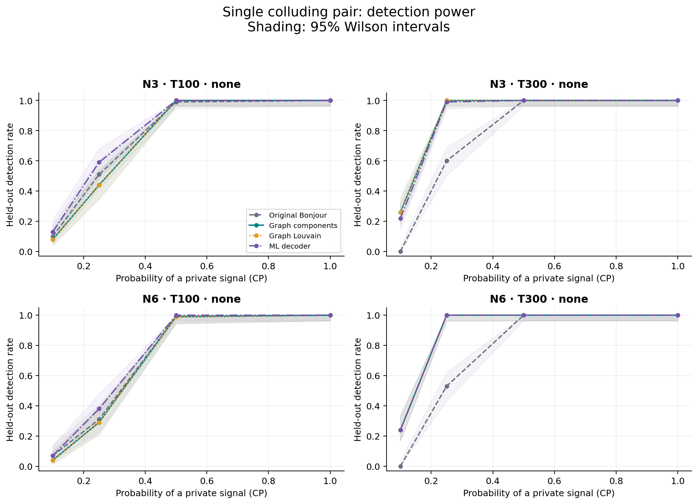
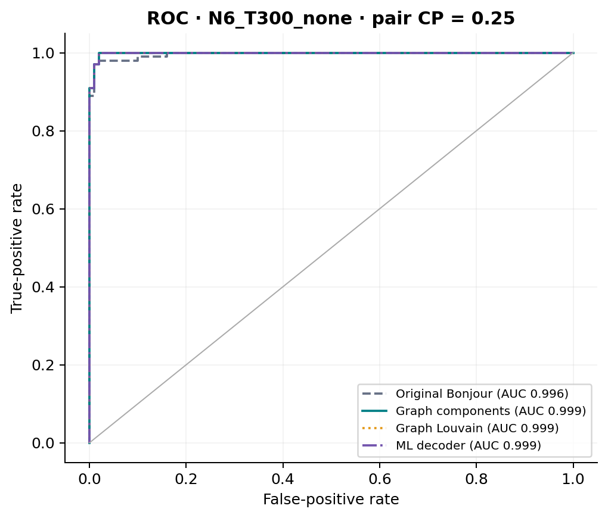
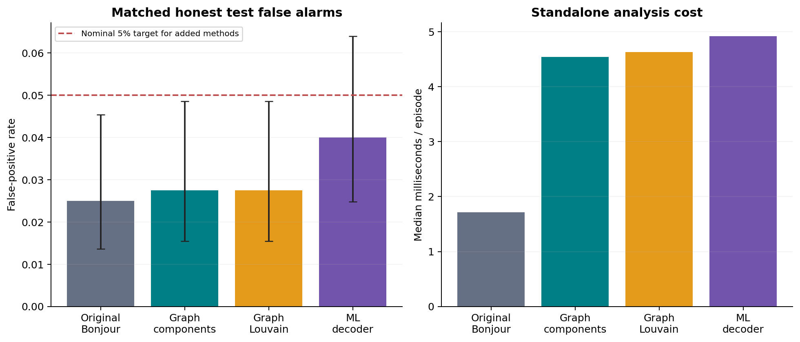
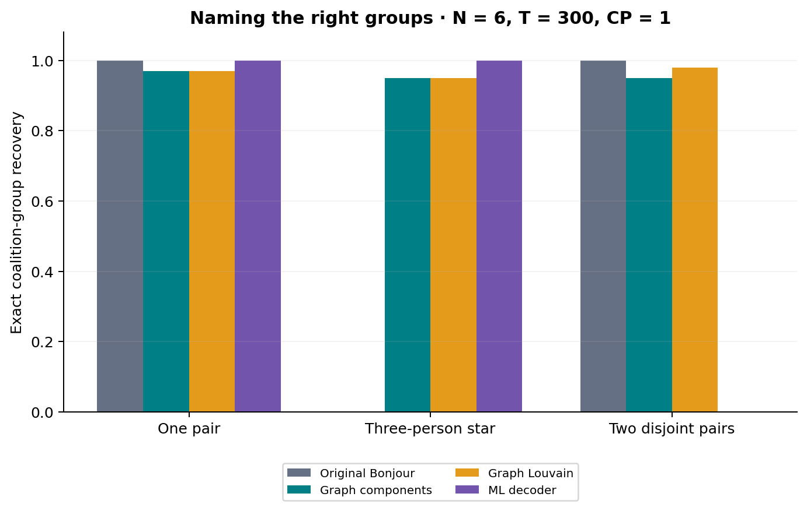
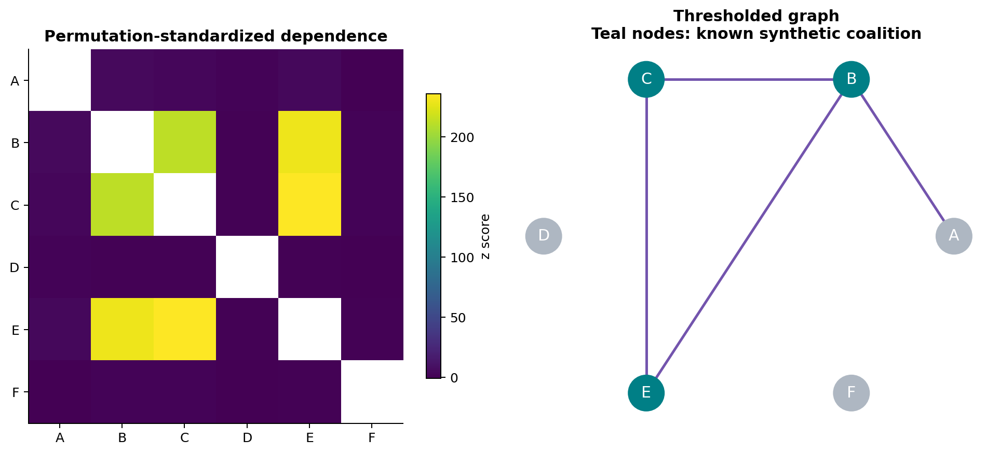

# RPS detection results

Source: **target simulator random backend + explicit synthetic stress models**. 6,253 games total;
4,300 held-out tests. Evaluation: 81.8 seconds.
Generated datasets use scripted players, not LLMs. Imported logs use the labels supplied in their manifest.

## Main comparison

This mixture contains 3,200 test games. ML decoder has the highest recall
(81.7%); Graph Louvain has the highest exact group recovery
(73.3%). These are descriptive comparisons of this mixture.

| Method | FPR [95% CI] | Recall [95% CI] | Precision | F1 | Macro AUROC | Exact groups | Jaccard | Median ms |
| --- | --- | --- | --- | --- | --- | --- | --- | --- |
| Original Bonjour | 2.5% [1.4%, 4.5%] | 59.3% [57.5%, 61.1%] | 0.994 | 0.743 | 0.835 | 0.513 | 0.559 | 1.72 |
| Graph components | 2.8% [1.5%, 4.9%] | 79.7% [78.2%, 81.2%] | 0.995 | 0.885 | 0.897 | 0.731 | 0.770 | 4.54 |
| Graph Louvain | 2.8% [1.5%, 4.9%] | 79.7% [78.2%, 81.2%] | 0.995 | 0.885 | 0.897 | 0.733 | 0.770 | 4.63 |
| ML decoder | 4.0% [2.5%, 6.4%] | 81.7% [80.2%, 83.1%] | 0.993 | 0.897 | 0.930 | 0.563 | 0.695 | 4.92 |

Intervals are 95% Wilson intervals. Recovery counts missed detections and abstentions as failures.
Honest games are counted once. Precision and F1 depend on the chosen prevalence.
Macro AUROC averages within-condition AUROCs; scores from different calibrations are not comparable.
Each added method's runtime includes the shared pair-evidence calculation, as if it ran alone.

## Methods and calibration

Methods in this report: Original Bonjour, Graph components, Graph Louvain, ML decoder.
All use pairwise action dependence. The graph methods can return several groups;
ML and growth return one. No private signals or true memberships enter their features.

Pair scores use conditional MI, standardized against shuffled moves within each public state.
The settings are 99 shuffles,
a minimum of 20 observations per pair and
10 per retained state.
Missing evidence remains undefined. The baseline uses complete rounds.

Honest edge-fit games set the graph threshold. Separate honest calibration games set final
score thresholds before testing. Rank cutoffs target a marginal 5% false-positive rate when
calibration and future honest games are exchangeable. They do not guarantee a particular
realized rate for each fitted threshold or for a changed policy population.
Bonjour keeps its original 0.05-nat threshold. Combining methods needs separate calibration.

Growth uses the strongest-pair z for detection and relative average-z expansion for naming.
Its default join fraction is 0.25. ML uses an estimated Gaussian score and a group-size penalty;
that working model does not establish independent pair evidence or a posterior probability.
Sources and revisions are listed in the repository's ATTRIBUTION.md.

| Calibration group | Edge fit | Calibration | Held-out test |
| --- | --- | --- | --- |
| N3_T100_none | 80 | 199 | 500 |
| N3_T300_none | 80 | 199 | 500 |
| N6_T100_none | 80 | 199 | 1100 |
| N6_T300_none | 80 | 199 | 1300 |
| N3_T300_last_round | 80 | 199 | 300 |
| N6_T300_last_round | 80 | 199 | 300 |
| N6_T300_public_state | 80 | 199 | 300 |

## Scenarios

`pair` has one primary and one assistant. `star3` has one primary and two assistants.
`two_pairs` has two separate primary/assistant pairs. CP is the chance of a private signal;
labels describe the configured mechanism, not an inferred intention. Membership is randomized
per episode. Seed: 20261024. Duplicate IDs and observed trajectories are rejected.

`parity` is a synthetic higher-order case with pairwise-independent coalition actions.
`shared_state_ignored` tests honest players responding to an omitted public cause; it is outside
the matched calibration population. `public_state` includes that cause. `last_round` tests
previous-action conditioning, which can leave too few observations per state.

## Paired comparison with Bonjour

| Compared with original | Metric | Difference [paired bootstrap 95% CI] |
| --- | --- | --- |
| Graph components | Recall | +20.4% [+18.9%, +22.1%] |
| Graph components | Exact groups | +21.8% [+20.0%, +23.6%] |
| Graph Louvain | Recall | +20.4% [+18.9%, +22.1%] |
| Graph Louvain | Exact groups | +22.0% [+20.3%, +23.8%] |
| ML decoder | Recall | +22.4% [+20.8%, +24.1%] |
| ML decoder | Exact groups | +5.0% [+2.7%, +7.2%] |

Intervals use 2,000 paired episode-bootstrap resamples of this fixed test mixture.
They exclude calibration-set uncertainty and are not adjusted for multiple comparisons.

## Figures

PNG and SVG files are saved in `figures/`. ROC sweeps do not change the frozen decisions.
The example graph is the first N=6, T=300, CP=1 star case, selected by position rather than success.

## Results by condition

| Group | Scenario | CP | Method | Recall | FPR | AUROC | Exact groups | Pair F1 |
| --- | --- | --- | --- | --- | --- | --- | --- | --- |
| N3_T100_none | pair | 0.1 | Original Bonjour | 0.100 | 0.070 | 0.574 | 0.100 | 0.100 |
| N3_T100_none | pair | 0.25 | Original Bonjour | 0.510 | 0.070 | 0.851 | 0.510 | 0.510 |
| N3_T100_none | pair | 0.5 | Original Bonjour | 0.990 | 0.070 | 0.999 | 0.990 | 0.990 |
| N3_T100_none | pair | 1.0 | Original Bonjour | 1.000 | 0.070 | 1.000 | 1.000 | 1.000 |
| N3_T100_none | pair | 0.1 | Graph components | 0.080 | 0.040 | 0.521 | 0.080 | 0.080 |
| N3_T100_none | pair | 0.25 | Graph components | 0.440 | 0.040 | 0.705 | 0.440 | 0.440 |
| N3_T100_none | pair | 0.5 | Graph components | 1.000 | 0.040 | 1.000 | 1.000 | 1.000 |
| N3_T100_none | pair | 1.0 | Graph components | 1.000 | 0.040 | 1.000 | 0.980 | 0.990 |
| N3_T100_none | pair | 0.1 | Graph Louvain | 0.080 | 0.040 | 0.521 | 0.080 | 0.080 |
| N3_T100_none | pair | 0.25 | Graph Louvain | 0.440 | 0.040 | 0.705 | 0.440 | 0.440 |
| N3_T100_none | pair | 0.5 | Graph Louvain | 1.000 | 0.040 | 1.000 | 1.000 | 1.000 |
| N3_T100_none | pair | 1.0 | Graph Louvain | 1.000 | 0.040 | 1.000 | 0.980 | 0.990 |
| N3_T100_none | pair | 0.1 | ML decoder | 0.130 | 0.050 | 0.655 | 0.110 | 0.120 |
| N3_T100_none | pair | 0.25 | ML decoder | 0.590 | 0.050 | 0.898 | 0.560 | 0.575 |
| N3_T100_none | pair | 0.5 | ML decoder | 1.000 | 0.050 | 1.000 | 1.000 | 1.000 |
| N3_T100_none | pair | 1.0 | ML decoder | 1.000 | 0.050 | 1.000 | 1.000 | 1.000 |
| N3_T300_none | pair | 0.1 | Original Bonjour | 0.000 | 0.000 | 0.690 | 0.000 | 0.000 |
| N3_T300_none | pair | 0.25 | Original Bonjour | 0.600 | 0.000 | 0.999 | 0.600 | 0.600 |
| N3_T300_none | pair | 0.5 | Original Bonjour | 1.000 | 0.000 | 1.000 | 1.000 | 1.000 |
| N3_T300_none | pair | 1.0 | Original Bonjour | 1.000 | 0.000 | 1.000 | 1.000 | 1.000 |
| N3_T300_none | pair | 0.1 | Graph components | 0.260 | 0.020 | 0.650 | 0.200 | 0.215 |
| N3_T300_none | pair | 0.25 | Graph components | 1.000 | 0.020 | 1.000 | 0.910 | 0.955 |
| N3_T300_none | pair | 0.5 | Graph components | 1.000 | 0.020 | 1.000 | 0.940 | 0.970 |
| N3_T300_none | pair | 1.0 | Graph components | 1.000 | 0.020 | 1.000 | 0.950 | 0.975 |
| N3_T300_none | pair | 0.1 | Graph Louvain | 0.260 | 0.020 | 0.650 | 0.200 | 0.215 |
| N3_T300_none | pair | 0.25 | Graph Louvain | 1.000 | 0.020 | 1.000 | 0.910 | 0.955 |
| N3_T300_none | pair | 0.5 | Graph Louvain | 1.000 | 0.020 | 1.000 | 0.940 | 0.970 |
| N3_T300_none | pair | 1.0 | Graph Louvain | 1.000 | 0.020 | 1.000 | 0.950 | 0.975 |
| N3_T300_none | pair | 0.1 | ML decoder | 0.220 | 0.020 | 0.749 | 0.180 | 0.185 |
| N3_T300_none | pair | 0.25 | ML decoder | 0.990 | 0.020 | 1.000 | 0.990 | 0.990 |
| N3_T300_none | pair | 0.5 | ML decoder | 1.000 | 0.020 | 1.000 | 1.000 | 1.000 |
| N3_T300_none | pair | 1.0 | ML decoder | 1.000 | 0.020 | 1.000 | 1.000 | 1.000 |
| N6_T100_none | pair | 0.1 | Original Bonjour | 0.070 | 0.030 | 0.460 | 0.030 | 0.030 |
| N6_T100_none | pair | 0.25 | Original Bonjour | 0.310 | 0.030 | 0.722 | 0.290 | 0.290 |
| N6_T100_none | pair | 0.5 | Original Bonjour | 0.990 | 0.030 | 0.997 | 0.990 | 0.990 |
| N6_T100_none | pair | 1.0 | Original Bonjour | 1.000 | 0.030 | 1.000 | 1.000 | 1.000 |
| N6_T100_none | star3 | 0.25 | Original Bonjour | 0.200 | 0.030 | 0.632 | 0.000 | 0.100 |
| N6_T100_none | star3 | 0.5 | Original Bonjour | 0.580 | 0.030 | 0.857 | 0.000 | 0.285 |
| N6_T100_none | star3 | 1.0 | Original Bonjour | 0.010 | 0.030 | 0.207 | 0.000 | 0.000 |
| N6_T100_none | two_pairs | 0.25 | Original Bonjour | 0.570 | 0.030 | 0.846 | 0.130 | 0.420 |
| N6_T100_none | two_pairs | 0.5 | Original Bonjour | 1.000 | 0.030 | 1.000 | 1.000 | 1.000 |
| N6_T100_none | two_pairs | 1.0 | Original Bonjour | 1.000 | 0.030 | 1.000 | 0.990 | 0.998 |
| N6_T100_none | pair | 0.1 | Graph components | 0.040 | 0.010 | 0.515 | 0.020 | 0.020 |
| N6_T100_none | pair | 0.25 | Graph components | 0.290 | 0.010 | 0.641 | 0.250 | 0.265 |
| N6_T100_none | pair | 0.5 | Graph components | 0.990 | 0.010 | 0.995 | 0.990 | 0.990 |
| N6_T100_none | pair | 1.0 | Graph components | 1.000 | 0.010 | 1.000 | 0.970 | 0.985 |
| N6_T100_none | star3 | 0.25 | Graph components | 0.440 | 0.010 | 0.716 | 0.050 | 0.227 |
| N6_T100_none | star3 | 0.5 | Graph components | 1.000 | 0.010 | 1.000 | 0.990 | 0.997 |
| N6_T100_none | star3 | 1.0 | Graph components | 1.000 | 0.010 | 1.000 | 1.000 | 1.000 |
| N6_T100_none | two_pairs | 0.25 | Graph components | 0.540 | 0.010 | 0.767 | 0.100 | 0.387 |
| N6_T100_none | two_pairs | 0.5 | Graph components | 1.000 | 0.010 | 1.000 | 0.980 | 0.992 |
| N6_T100_none | two_pairs | 1.0 | Graph components | 1.000 | 0.010 | 1.000 | 0.980 | 0.993 |
| N6_T100_none | pair | 0.1 | Graph Louvain | 0.040 | 0.010 | 0.515 | 0.020 | 0.020 |
| N6_T100_none | pair | 0.25 | Graph Louvain | 0.290 | 0.010 | 0.641 | 0.250 | 0.265 |
| N6_T100_none | pair | 0.5 | Graph Louvain | 0.990 | 0.010 | 0.995 | 0.990 | 0.990 |
| N6_T100_none | pair | 1.0 | Graph Louvain | 1.000 | 0.010 | 1.000 | 0.970 | 0.985 |
| N6_T100_none | star3 | 0.25 | Graph Louvain | 0.440 | 0.010 | 0.716 | 0.050 | 0.227 |
| N6_T100_none | star3 | 0.5 | Graph Louvain | 1.000 | 0.010 | 1.000 | 0.990 | 0.994 |
| N6_T100_none | star3 | 1.0 | Graph Louvain | 1.000 | 0.010 | 1.000 | 1.000 | 1.000 |
| N6_T100_none | two_pairs | 0.25 | Graph Louvain | 0.540 | 0.010 | 0.767 | 0.100 | 0.387 |
| N6_T100_none | two_pairs | 0.5 | Graph Louvain | 1.000 | 0.010 | 1.000 | 0.990 | 0.997 |
| N6_T100_none | two_pairs | 1.0 | Graph Louvain | 1.000 | 0.010 | 1.000 | 0.980 | 0.993 |
| N6_T100_none | pair | 0.1 | ML decoder | 0.070 | 0.050 | 0.507 | 0.020 | 0.020 |
| N6_T100_none | pair | 0.25 | ML decoder | 0.380 | 0.050 | 0.779 | 0.310 | 0.330 |
| N6_T100_none | pair | 0.5 | ML decoder | 1.000 | 0.050 | 1.000 | 0.990 | 0.995 |
| N6_T100_none | pair | 1.0 | ML decoder | 1.000 | 0.050 | 1.000 | 1.000 | 1.000 |
| N6_T100_none | star3 | 0.25 | ML decoder | 0.570 | 0.050 | 0.902 | 0.180 | 0.365 |
| N6_T100_none | star3 | 0.5 | ML decoder | 1.000 | 0.050 | 1.000 | 0.770 | 0.885 |
| N6_T100_none | star3 | 1.0 | ML decoder | 1.000 | 0.050 | 1.000 | 1.000 | 1.000 |
| N6_T100_none | two_pairs | 0.25 | ML decoder | 0.690 | 0.050 | 0.902 | 0.000 | 0.433 |
| N6_T100_none | two_pairs | 0.5 | ML decoder | 1.000 | 0.050 | 1.000 | 0.000 | 0.667 |
| N6_T100_none | two_pairs | 1.0 | ML decoder | 1.000 | 0.050 | 1.000 | 0.000 | 0.667 |
| N6_T300_none | pair | 0.1 | Original Bonjour | 0.000 | 0.000 | 0.588 | 0.000 | 0.000 |
| N6_T300_none | pair | 0.25 | Original Bonjour | 0.530 | 0.000 | 0.996 | 0.530 | 0.530 |
| N6_T300_none | pair | 0.5 | Original Bonjour | 1.000 | 0.000 | 1.000 | 1.000 | 1.000 |
| N6_T300_none | pair | 1.0 | Original Bonjour | 1.000 | 0.000 | 1.000 | 1.000 | 1.000 |
| N6_T300_none | star3 | 0.25 | Original Bonjour | 0.090 | 0.000 | 0.823 | 0.000 | 0.045 |
| N6_T300_none | star3 | 0.5 | Original Bonjour | 0.350 | 0.000 | 0.935 | 0.000 | 0.175 |
| N6_T300_none | star3 | 1.0 | Original Bonjour | 0.000 | 0.000 | 0.209 | 0.000 | 0.000 |
| N6_T300_none | two_pairs | 0.25 | Original Bonjour | 0.700 | 0.000 | 0.999 | 0.210 | 0.537 |
| N6_T300_none | two_pairs | 0.5 | Original Bonjour | 1.000 | 0.000 | 1.000 | 1.000 | 1.000 |
| N6_T300_none | two_pairs | 1.0 | Original Bonjour | 1.000 | 0.000 | 1.000 | 1.000 | 1.000 |
| N6_T300_none | pair | 0.1 | Graph components | 0.240 | 0.040 | 0.604 | 0.130 | 0.130 |
| N6_T300_none | pair | 0.25 | Graph components | 1.000 | 0.040 | 0.999 | 0.930 | 0.968 |
| N6_T300_none | pair | 0.5 | Graph components | 1.000 | 0.040 | 1.000 | 0.950 | 0.977 |
| N6_T300_none | pair | 1.0 | Graph components | 1.000 | 0.040 | 1.000 | 0.970 | 0.984 |
| N6_T300_none | star3 | 0.25 | Graph components | 1.000 | 0.040 | 1.000 | 0.920 | 0.975 |
| N6_T300_none | star3 | 0.5 | Graph components | 1.000 | 0.040 | 1.000 | 0.930 | 0.977 |
| N6_T300_none | star3 | 1.0 | Graph components | 1.000 | 0.040 | 1.000 | 0.950 | 0.987 |
| N6_T300_none | two_pairs | 0.25 | Graph components | 1.000 | 0.040 | 1.000 | 0.960 | 0.987 |
| N6_T300_none | two_pairs | 0.5 | Graph components | 1.000 | 0.040 | 1.000 | 0.940 | 0.977 |
| N6_T300_none | two_pairs | 1.0 | Graph components | 1.000 | 0.040 | 1.000 | 0.950 | 0.978 |
| N6_T300_none | pair | 0.1 | Graph Louvain | 0.240 | 0.040 | 0.604 | 0.130 | 0.130 |
| N6_T300_none | pair | 0.25 | Graph Louvain | 1.000 | 0.040 | 0.999 | 0.930 | 0.968 |
| N6_T300_none | pair | 0.5 | Graph Louvain | 1.000 | 0.040 | 1.000 | 0.950 | 0.977 |
| N6_T300_none | pair | 1.0 | Graph Louvain | 1.000 | 0.040 | 1.000 | 0.970 | 0.984 |
| N6_T300_none | star3 | 0.25 | Graph Louvain | 1.000 | 0.040 | 1.000 | 0.920 | 0.970 |
| N6_T300_none | star3 | 0.5 | Graph Louvain | 1.000 | 0.040 | 1.000 | 0.930 | 0.977 |
| N6_T300_none | star3 | 1.0 | Graph Louvain | 1.000 | 0.040 | 1.000 | 0.950 | 0.987 |
| N6_T300_none | two_pairs | 0.25 | Graph Louvain | 1.000 | 0.040 | 1.000 | 0.960 | 0.987 |
| N6_T300_none | two_pairs | 0.5 | Graph Louvain | 1.000 | 0.040 | 1.000 | 0.960 | 0.987 |
| N6_T300_none | two_pairs | 1.0 | Graph Louvain | 1.000 | 0.040 | 1.000 | 0.980 | 0.993 |
| N6_T300_none | pair | 0.1 | ML decoder | 0.240 | 0.040 | 0.657 | 0.130 | 0.135 |
| N6_T300_none | pair | 0.25 | ML decoder | 1.000 | 0.040 | 0.999 | 1.000 | 1.000 |
| N6_T300_none | pair | 0.5 | ML decoder | 1.000 | 0.040 | 1.000 | 1.000 | 1.000 |
| N6_T300_none | pair | 1.0 | ML decoder | 1.000 | 0.040 | 1.000 | 1.000 | 1.000 |
| N6_T300_none | star3 | 0.25 | ML decoder | 1.000 | 0.040 | 1.000 | 0.540 | 0.770 |
| N6_T300_none | star3 | 0.5 | ML decoder | 1.000 | 0.040 | 1.000 | 0.980 | 0.990 |
| N6_T300_none | star3 | 1.0 | ML decoder | 1.000 | 0.040 | 1.000 | 1.000 | 1.000 |
| N6_T300_none | two_pairs | 0.25 | ML decoder | 1.000 | 0.040 | 1.000 | 0.000 | 0.665 |
| N6_T300_none | two_pairs | 0.5 | ML decoder | 1.000 | 0.040 | 1.000 | 0.000 | 0.667 |
| N6_T300_none | two_pairs | 1.0 | ML decoder | 1.000 | 0.040 | 1.000 | 0.000 | 0.667 |

Exact groups requires the complete set of groups to match. Exact members compares their union.
Jaccard and pair F1 measure overlap; their denominators include missed detections.

## Stress tests

| Group | Scenario | Method | n | Flag rate [95% CI] | Abstain | Supported pairs |
| --- | --- | --- | --- | --- | --- | --- |
| N3_T300_last_round | honest | Original Bonjour | 100 | 6.0% [2.8%, 12.5%] | 0.000 | 1.000 |
| N3_T300_last_round | honest | Graph components | 100 | 5.0% [2.2%, 11.2%] | 0.000 | 1.000 |
| N3_T300_last_round | honest | Graph Louvain | 100 | 5.0% [2.2%, 11.2%] | 0.000 | 1.000 |
| N3_T300_last_round | honest | ML decoder | 100 | 4.0% [1.6%, 9.8%] | 0.000 | 1.000 |
| N3_T300_last_round | pair | Original Bonjour | 200 | 100.0% [98.1%, 100.0%] | 0.000 | 1.000 |
| N3_T300_last_round | pair | Graph components | 200 | 100.0% [98.1%, 100.0%] | 0.000 | 1.000 |
| N3_T300_last_round | pair | Graph Louvain | 200 | 100.0% [98.1%, 100.0%] | 0.000 | 1.000 |
| N3_T300_last_round | pair | ML decoder | 200 | 100.0% [98.1%, 100.0%] | 0.000 | 1.000 |
| N6_T300_last_round | honest | Original Bonjour | 100 | 0.0% [0.0%, 3.7%] | 0.000 | 0.000 |
| N6_T300_last_round | honest | Graph components | 100 | 0.0% [0.0%, 3.7%] | 1.000 | 0.000 |
| N6_T300_last_round | honest | Graph Louvain | 100 | 0.0% [0.0%, 3.7%] | 1.000 | 0.000 |
| N6_T300_last_round | honest | ML decoder | 100 | 0.0% [0.0%, 3.7%] | 1.000 | 0.000 |
| N6_T300_last_round | pair | Original Bonjour | 200 | 50.0% [43.1%, 56.9%] | 0.000 | 0.000 |
| N6_T300_last_round | pair | Graph components | 200 | 0.0% [0.0%, 1.9%] | 1.000 | 0.000 |
| N6_T300_last_round | pair | Graph Louvain | 200 | 0.0% [0.0%, 1.9%] | 1.000 | 0.000 |
| N6_T300_last_round | pair | ML decoder | 200 | 0.0% [0.0%, 1.9%] | 1.000 | 0.000 |
| N6_T300_none | parity | Original Bonjour | 100 | 0.0% [0.0%, 3.7%] | 0.000 | 1.000 |
| N6_T300_none | parity | Graph components | 100 | 4.0% [1.6%, 9.8%] | 0.000 | 1.000 |
| N6_T300_none | parity | Graph Louvain | 100 | 4.0% [1.6%, 9.8%] | 0.000 | 1.000 |
| N6_T300_none | parity | ML decoder | 100 | 6.0% [2.8%, 12.5%] | 0.000 | 1.000 |
| N6_T300_none | shared_state_ignored | Original Bonjour | 100 | 100.0% [96.3%, 100.0%] | 0.000 | 1.000 |
| N6_T300_none | shared_state_ignored | Graph components | 100 | 100.0% [96.3%, 100.0%] | 0.000 | 1.000 |
| N6_T300_none | shared_state_ignored | Graph Louvain | 100 | 100.0% [96.3%, 100.0%] | 0.000 | 1.000 |
| N6_T300_none | shared_state_ignored | ML decoder | 100 | 100.0% [96.3%, 100.0%] | 0.000 | 1.000 |
| N6_T300_public_state | honest | Original Bonjour | 100 | 0.0% [0.0%, 3.7%] | 0.000 | 1.000 |
| N6_T300_public_state | honest | Graph components | 100 | 7.0% [3.4%, 13.7%] | 0.000 | 1.000 |
| N6_T300_public_state | honest | Graph Louvain | 100 | 7.0% [3.4%, 13.7%] | 0.000 | 1.000 |
| N6_T300_public_state | honest | ML decoder | 100 | 4.0% [1.6%, 9.8%] | 0.000 | 1.000 |
| N6_T300_public_state | pair | Original Bonjour | 200 | 89.5% [84.5%, 93.0%] | 0.000 | 1.000 |
| N6_T300_public_state | pair | Graph components | 200 | 100.0% [98.1%, 100.0%] | 0.000 | 1.000 |
| N6_T300_public_state | pair | Graph Louvain | 200 | 100.0% [98.1%, 100.0%] | 0.000 | 1.000 |
| N6_T300_public_state | pair | ML decoder | 200 | 100.0% [98.1%, 100.0%] | 0.000 | 1.000 |

For honest cases, the flag rate is a false-positive rate. For coalition cases, it is a detection rate.
Pair rows here pool CP=0.5 and CP=1; use comparison.csv for separate conditions.
Abstention is not evidence of honesty. Pairwise methods can miss higher-order-only coordination,
and omitted public causes can create false alarms. Shuffling may be invalid for adaptive policies.
The recorded model populations do not cover all strategies or settings.

## Files and reproduction

See docs/RUNNING.md in the repository for complete commands. Use a fresh output directory.
To replay these trajectories, pass episodes.jsonl.gz to evaluate.py with --dataset.
Reports can be rebuilt with python -m rps.benchmark.report --results PATH.
Calibration must match the honest policies, state definition, player count and game length.

Predictions, condition metrics, summaries and thresholds are saved as CSV files.
calibration/*.json stores the thresholds; provenance.json records the run settings.
The six-view information experiment is a separate analysis of the observations.

Python: 3.12.14. Packages: {'numpy': '2.3.5', 'scipy': '1.17.0', 'networkx': '3.7', 'matplotlib': '3.10.8', 'scikit-learn': '1.8.0'}.
Dataset SHA-256: `09ab0b47b366b37442cd369c7700323a9c4fa4b88d3f5b167c6f6030889b9e98`.
