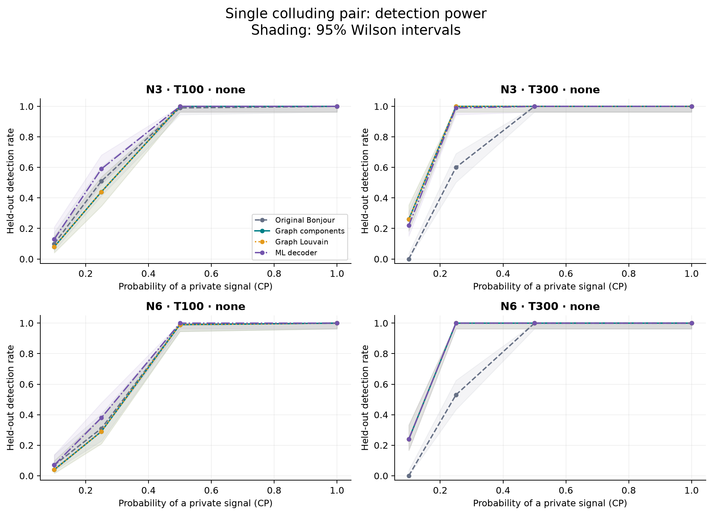
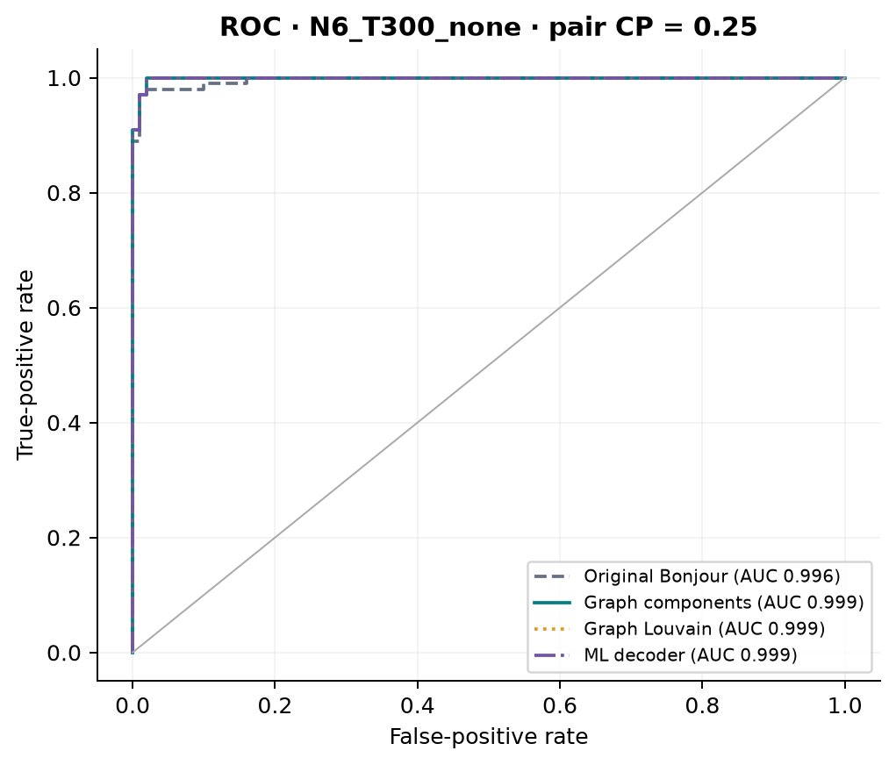
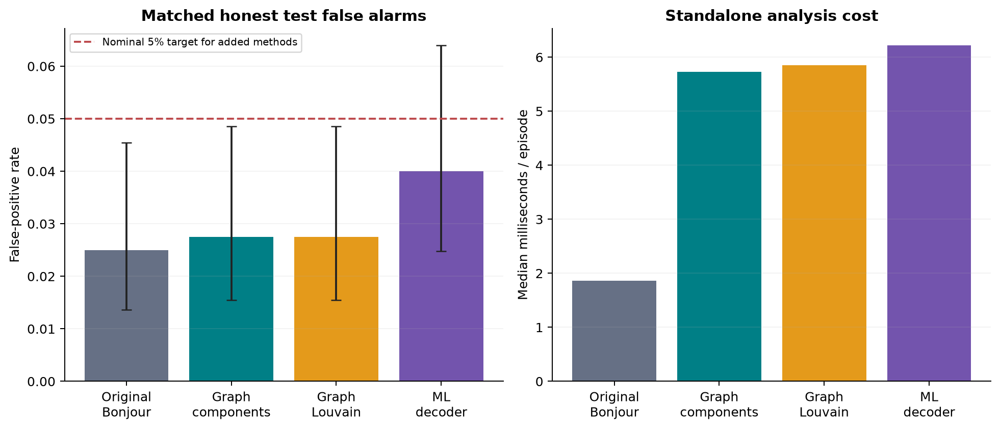
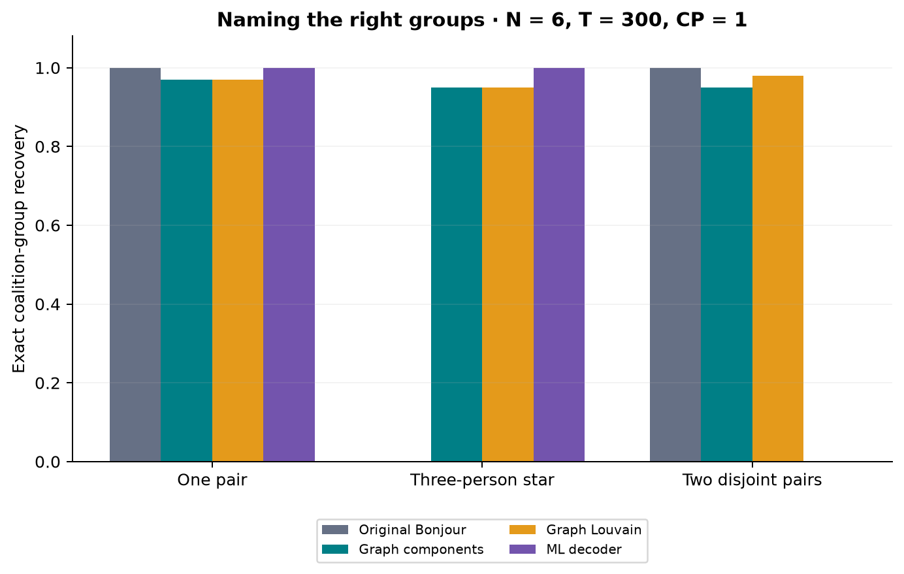
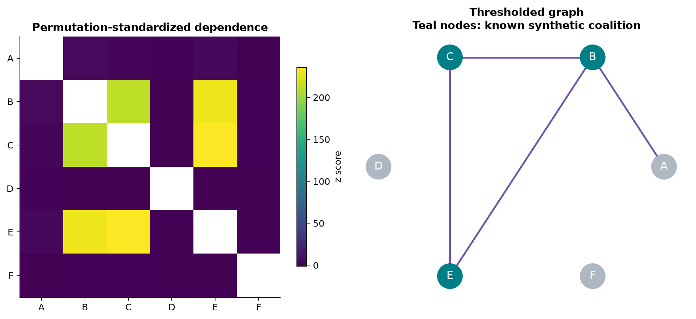

# RPS collusion detection: implemented methods and measured results

This report was generated by executing `evaluate.py`. Source: **target simulator random backend + explicit synthetic stress models**.
There are **6,253 total episodes**, including **4,300 held-out test episodes**.
Evaluation took 94.6 seconds on the recorded environment.
These are **scripted/synthetic benchmark results, not measured Ollama or real-player performance**, unless an external manifest is explicitly identified above.

## Main findings

In the main test mixture (3,200 episodes), ML decoder has the highest aggregate recall
(81.7%); Graph Louvain has the highest exact group recovery
(73.3%). Ties are possible; this is descriptive, not a significance claim.
The mixture contains several collusion strengths and group structures; use the per-condition table for a specific operating setting.

| Method | FPR [95% CI] | Recall [95% CI] | Precision | F1 | Macro AUROC | Exact groups | Jaccard | Median ms |
| --- | --- | --- | --- | --- | --- | --- | --- | --- |
| Original Bonjour | 2.5% [1.4%, 4.5%] | 59.3% [57.5%, 61.1%] | 0.994 | 0.743 | 0.835 | 0.513 | 0.559 | 1.86 |
| Graph components | 2.8% [1.5%, 4.9%] | 79.7% [78.2%, 81.2%] | 0.995 | 0.885 | 0.897 | 0.731 | 0.770 | 5.73 |
| Graph Louvain | 2.8% [1.5%, 4.9%] | 79.7% [78.2%, 81.2%] | 0.995 | 0.885 | 0.897 | 0.733 | 0.770 | 5.85 |
| ML decoder | 4.0% [2.5%, 6.4%] | 81.7% [80.2%, 83.1%] | 0.993 | 0.897 | 0.930 | 0.563 | 0.695 | 6.22 |

Precision and F1 depend on this constructed prevalence. Recall and naming metrics include every positive episode,
including abstentions and missed detections. Honest episodes are counted once, not repeated for each alternative.
Macro AUROC averages within-condition AUROCs; raw scores from different N/T calibrations are not pooled for that comparison.
`summary.csv` also preserves the raw pooled AUROC for audit only; it is not the headline comparison.
Intervals for rates are Wilson 95% intervals over independent episodes. Runtime includes common permutation evidence
for each added method, as if run alone; shared work is computed only once when all methods run together.

## What was adapted

| Source file | RPS implementation | Adaptation |
| --- | --- | --- |
| `colav/colav/observe/features.py` | `rps/observe/features.py` | rock/paper/scissors categorical actions; dynamic state cardinality; missing-action masks |
| `colav/colav/observe/views.py` | `rps/observe/views.py` | persistent identities, pseudonym blocks, anonymous move histograms, categorical summaries |
| `colav/colav/detect/graph.py` | `rps/detection/graph.py` | connected components and Louvain, separately evaluated and calibrated |
| `colav/colav/detect/decoder.py` | `rps/detection/decoder.py` | plug-in ML subset search with unknown coalition size; calibrated rejection before naming |
| Supporting `colav/colav/detect/pairwise.py` | `rps/detection/pairwise.py` | within-state permutations to standardize pairwise CMI |

The **three added methods** are graph components, graph Louvain, and the ML decoder. The unchanged
`rps/detect.py` is the original Bonjour baseline. Feature/view modules are shared observation machinery,
not additional detectors. Source revision and attribution are in [ATTRIBUTION.md](../../ATTRIBUTION.md).

### Statistics and decisions

1. Encode observed actions as three unordered categories. Public state is taken from the record, ignored,
   or reconstructed from the **previous** joint action. Neither current payoffs nor private signals are conditioning variables.
2. Estimate conditional mutual information `I(A_i; A_j | S)` in **nats**, matching the target repository.
   The auction code used bits; standardized z scores are unchanged by this unit conversion.
   For each pair, drop state cells with fewer than 10 jointly observed rounds;
   require at least 20 retained rounds. Unsupported pairs remain missing (NaN).
3. Shuffle one player's moves within each eligible state 99 times.
   Compute z relative to that empirical null; the implementation also returns add-one permutation p values.
4. On **edge-fit honest episodes**, calibrate a threshold on the largest pair z in each episode.
   For each graph extractor, score candidate groups by the sum of supported internal pair z values.
5. The decoder maximizes `mu * sum(z_ij) - mu²/2 * C(k,2) - ln C(N,k)` over k=2..min(N,k_max).
   Its plug-in mu is the mean of the strongest C(k,2) pair scores, floored at 1e-6. It never receives true k or true members.
   Missing edges contribute zero; wholly unsupported episodes abstain. Large searches use a clearly labeled greedy fallback.
6. On an **independent honest calibration split**, calibrate each graph's maximum group score and the decoder's score.
   Freeze the thresholds before processing test games. A candidate is returned only when its score strictly exceeds its cutoff.
   The graph methods can return several groups; the decoder returns at most one coalition.
7. The original baseline retains reciprocal net influence and its fixed **0.05-nat** threshold. It receives all complete
   rounds and does not inherit the new support guards or calibration. That is a reproduction of the target baseline,
   not a claim that its false-positive rate is matched to 5%.

Thresholds use rank `ceil((n+1)*(1-alpha))` with strict exceedance. Insufficient null samples give an infinite cutoff;
no-candidate null episodes count as non-detections rather than being silently removed. The graph edge fit is separate
from graph-score calibration, avoiding reusing the same null games to fit and assess a graph statistic.
The 5% target is a **marginal** guarantee under exchangeable honest episodes, not a promise that the realized FPR of
this fitted threshold equals 5%, and not a guarantee for combining all methods with an OR rule.

## Evaluation design

| Calibration group | Edge fit | Calibration | Held-out test |
| --- | --- | --- | --- |
| N3_T100_none | 80 | 199 | 500 |
| N3_T300_none | 80 | 199 | 500 |
| N6_T100_none | 80 | 199 | 1100 |
| N6_T300_none | 80 | 199 | 1300 |
| N3_T300_last_round | 80 | 199 | 300 |
| N6_T300_last_round | 80 | 199 | 300 |
| N6_T300_public_state | 80 | 199 | 300 |

Main cases are generated by the **target repository's `simulate.run` and `RandomPlayer`**, with the original scoring
and `assist_move` rule. The random backend runs sequentially to avoid thread overhead; Ollama execution remains concurrent.
Coalition names are randomized per episode using an independent seeded stream.
`pair` means one primary and one assistant; `star3` means one primary and two independently signalled assistants;
`two_pairs` means two disjoint primary/assistant pairs. CP is the chance of each private signal, not the observed cooperation rate.
Ground truth means the configured coalition mechanism is active (CP > 0), regardless of whether a short episode happened
to realize a signal. A positive result measures detectability of that mechanism, not intent inferred from a log.

The seed is 20261024. Each episode has a distinct SHA-256-derived RNG seed. IDs and hashes of observable
trajectories are checked for duplication. Private `signalled`, role, policy and truth fields never enter features.
No threshold is selected using test outcomes, collusion strength, coalition size, or coalition membership.

`parity` is a deliberately synthetic higher-order dependence control: the third coalition action is the modular sum
of two independent RPS actions. Each pair is independent in the population. It is **not** claimed to optimize RPS scores.
`shared_state_ignored` has two honest players responding independently to the same public context; analyzing with
state=`none` intentionally omits that context and uses uniform-player calibration. It is an **out-of-distribution false-alarm
stress test**, not part of the matched headline FPR. `public_state` conditions on the context and calibrates on the same
honest policy population. `last_round` tests the upstream history-state option and the resulting sparse state space.

## Paired comparison with the original detector

| Compared with original | Metric | Difference [paired bootstrap 95% CI] |
| --- | --- | --- |
| Graph components | Recall | +20.4% [+18.9%, +22.1%] |
| Graph components | Exact groups | +21.8% [+20.0%, +23.6%] |
| Graph Louvain | Recall | +20.4% [+18.9%, +22.1%] |
| Graph Louvain | Exact groups | +22.0% [+20.3%, +23.8%] |
| ML decoder | Recall | +22.4% [+20.8%, +24.1%] |
| ML decoder | Exact groups | +5.0% [+2.7%, +7.2%] |

Differences use the same positive test episodes for both methods. Percentile intervals come from 2,000 paired
episode bootstrap resamples of this fixed benchmark mixture. They do not account for calibration-set uncertainty
or the choice of synthetic model and are not adjusted for multiple comparisons.

## Figures











PNG and vector SVG versions are included in `figures/`. ROC thresholds in the plot are diagnostic sweeps;
they do not change the independently calibrated decisions used elsewhere in this report.
The example graph is the first N=6, T=300, CP=1 three-person-star test episode, selected by position rather
than detection success. An edge to an honest node illustrates why group recovery can lag detection.

## Results by condition

| Group | Scenario | CP | Method | Recall | FPR | AUROC | Exact groups | Pair F1 |
| --- | --- | --- | --- | --- | --- | --- | --- | --- |
| N3_T100_none | pair | 0.1 | Original Bonjour | 0.100 | 0.070 | 0.574 | 0.100 | 0.100 |
| N3_T100_none | pair | 0.25 | Original Bonjour | 0.510 | 0.070 | 0.851 | 0.510 | 0.510 |
| N3_T100_none | pair | 0.5 | Original Bonjour | 0.990 | 0.070 | 0.999 | 0.990 | 0.990 |
| N3_T100_none | pair | 1.0 | Original Bonjour | 1.000 | 0.070 | 1.000 | 1.000 | 1.000 |
| N3_T100_none | pair | 0.1 | Graph components | 0.080 | 0.040 | 0.521 | 0.080 | 0.080 |
| N3_T100_none | pair | 0.25 | Graph components | 0.440 | 0.040 | 0.705 | 0.440 | 0.440 |
| N3_T100_none | pair | 0.5 | Graph components | 1.000 | 0.040 | 1.000 | 1.000 | 1.000 |
| N3_T100_none | pair | 1.0 | Graph components | 1.000 | 0.040 | 1.000 | 0.980 | 0.990 |
| N3_T100_none | pair | 0.1 | Graph Louvain | 0.080 | 0.040 | 0.521 | 0.080 | 0.080 |
| N3_T100_none | pair | 0.25 | Graph Louvain | 0.440 | 0.040 | 0.705 | 0.440 | 0.440 |
| N3_T100_none | pair | 0.5 | Graph Louvain | 1.000 | 0.040 | 1.000 | 1.000 | 1.000 |
| N3_T100_none | pair | 1.0 | Graph Louvain | 1.000 | 0.040 | 1.000 | 0.980 | 0.990 |
| N3_T100_none | pair | 0.1 | ML decoder | 0.130 | 0.050 | 0.655 | 0.110 | 0.120 |
| N3_T100_none | pair | 0.25 | ML decoder | 0.590 | 0.050 | 0.898 | 0.560 | 0.575 |
| N3_T100_none | pair | 0.5 | ML decoder | 1.000 | 0.050 | 1.000 | 1.000 | 1.000 |
| N3_T100_none | pair | 1.0 | ML decoder | 1.000 | 0.050 | 1.000 | 1.000 | 1.000 |
| N3_T300_none | pair | 0.1 | Original Bonjour | 0.000 | 0.000 | 0.690 | 0.000 | 0.000 |
| N3_T300_none | pair | 0.25 | Original Bonjour | 0.600 | 0.000 | 0.999 | 0.600 | 0.600 |
| N3_T300_none | pair | 0.5 | Original Bonjour | 1.000 | 0.000 | 1.000 | 1.000 | 1.000 |
| N3_T300_none | pair | 1.0 | Original Bonjour | 1.000 | 0.000 | 1.000 | 1.000 | 1.000 |
| N3_T300_none | pair | 0.1 | Graph components | 0.260 | 0.020 | 0.650 | 0.200 | 0.215 |
| N3_T300_none | pair | 0.25 | Graph components | 1.000 | 0.020 | 1.000 | 0.910 | 0.955 |
| N3_T300_none | pair | 0.5 | Graph components | 1.000 | 0.020 | 1.000 | 0.940 | 0.970 |
| N3_T300_none | pair | 1.0 | Graph components | 1.000 | 0.020 | 1.000 | 0.950 | 0.975 |
| N3_T300_none | pair | 0.1 | Graph Louvain | 0.260 | 0.020 | 0.650 | 0.200 | 0.215 |
| N3_T300_none | pair | 0.25 | Graph Louvain | 1.000 | 0.020 | 1.000 | 0.910 | 0.955 |
| N3_T300_none | pair | 0.5 | Graph Louvain | 1.000 | 0.020 | 1.000 | 0.940 | 0.970 |
| N3_T300_none | pair | 1.0 | Graph Louvain | 1.000 | 0.020 | 1.000 | 0.950 | 0.975 |
| N3_T300_none | pair | 0.1 | ML decoder | 0.220 | 0.020 | 0.749 | 0.180 | 0.185 |
| N3_T300_none | pair | 0.25 | ML decoder | 0.990 | 0.020 | 1.000 | 0.990 | 0.990 |
| N3_T300_none | pair | 0.5 | ML decoder | 1.000 | 0.020 | 1.000 | 1.000 | 1.000 |
| N3_T300_none | pair | 1.0 | ML decoder | 1.000 | 0.020 | 1.000 | 1.000 | 1.000 |
| N6_T100_none | pair | 0.1 | Original Bonjour | 0.070 | 0.030 | 0.460 | 0.030 | 0.030 |
| N6_T100_none | pair | 0.25 | Original Bonjour | 0.310 | 0.030 | 0.722 | 0.290 | 0.290 |
| N6_T100_none | pair | 0.5 | Original Bonjour | 0.990 | 0.030 | 0.997 | 0.990 | 0.990 |
| N6_T100_none | pair | 1.0 | Original Bonjour | 1.000 | 0.030 | 1.000 | 1.000 | 1.000 |
| N6_T100_none | star3 | 0.25 | Original Bonjour | 0.200 | 0.030 | 0.632 | 0.000 | 0.100 |
| N6_T100_none | star3 | 0.5 | Original Bonjour | 0.580 | 0.030 | 0.857 | 0.000 | 0.285 |
| N6_T100_none | star3 | 1.0 | Original Bonjour | 0.010 | 0.030 | 0.207 | 0.000 | 0.000 |
| N6_T100_none | two_pairs | 0.25 | Original Bonjour | 0.570 | 0.030 | 0.846 | 0.130 | 0.420 |
| N6_T100_none | two_pairs | 0.5 | Original Bonjour | 1.000 | 0.030 | 1.000 | 1.000 | 1.000 |
| N6_T100_none | two_pairs | 1.0 | Original Bonjour | 1.000 | 0.030 | 1.000 | 0.990 | 0.998 |
| N6_T100_none | pair | 0.1 | Graph components | 0.040 | 0.010 | 0.515 | 0.020 | 0.020 |
| N6_T100_none | pair | 0.25 | Graph components | 0.290 | 0.010 | 0.641 | 0.250 | 0.265 |
| N6_T100_none | pair | 0.5 | Graph components | 0.990 | 0.010 | 0.995 | 0.990 | 0.990 |
| N6_T100_none | pair | 1.0 | Graph components | 1.000 | 0.010 | 1.000 | 0.970 | 0.985 |
| N6_T100_none | star3 | 0.25 | Graph components | 0.440 | 0.010 | 0.716 | 0.050 | 0.227 |
| N6_T100_none | star3 | 0.5 | Graph components | 1.000 | 0.010 | 1.000 | 0.990 | 0.997 |
| N6_T100_none | star3 | 1.0 | Graph components | 1.000 | 0.010 | 1.000 | 1.000 | 1.000 |
| N6_T100_none | two_pairs | 0.25 | Graph components | 0.540 | 0.010 | 0.767 | 0.100 | 0.387 |
| N6_T100_none | two_pairs | 0.5 | Graph components | 1.000 | 0.010 | 1.000 | 0.980 | 0.992 |
| N6_T100_none | two_pairs | 1.0 | Graph components | 1.000 | 0.010 | 1.000 | 0.980 | 0.993 |
| N6_T100_none | pair | 0.1 | Graph Louvain | 0.040 | 0.010 | 0.515 | 0.020 | 0.020 |
| N6_T100_none | pair | 0.25 | Graph Louvain | 0.290 | 0.010 | 0.641 | 0.250 | 0.265 |
| N6_T100_none | pair | 0.5 | Graph Louvain | 0.990 | 0.010 | 0.995 | 0.990 | 0.990 |
| N6_T100_none | pair | 1.0 | Graph Louvain | 1.000 | 0.010 | 1.000 | 0.970 | 0.985 |
| N6_T100_none | star3 | 0.25 | Graph Louvain | 0.440 | 0.010 | 0.716 | 0.050 | 0.227 |
| N6_T100_none | star3 | 0.5 | Graph Louvain | 1.000 | 0.010 | 1.000 | 0.990 | 0.994 |
| N6_T100_none | star3 | 1.0 | Graph Louvain | 1.000 | 0.010 | 1.000 | 1.000 | 1.000 |
| N6_T100_none | two_pairs | 0.25 | Graph Louvain | 0.540 | 0.010 | 0.767 | 0.100 | 0.387 |
| N6_T100_none | two_pairs | 0.5 | Graph Louvain | 1.000 | 0.010 | 1.000 | 0.990 | 0.997 |
| N6_T100_none | two_pairs | 1.0 | Graph Louvain | 1.000 | 0.010 | 1.000 | 0.980 | 0.993 |
| N6_T100_none | pair | 0.1 | ML decoder | 0.070 | 0.050 | 0.507 | 0.020 | 0.020 |
| N6_T100_none | pair | 0.25 | ML decoder | 0.380 | 0.050 | 0.779 | 0.310 | 0.330 |
| N6_T100_none | pair | 0.5 | ML decoder | 1.000 | 0.050 | 1.000 | 0.990 | 0.995 |
| N6_T100_none | pair | 1.0 | ML decoder | 1.000 | 0.050 | 1.000 | 1.000 | 1.000 |
| N6_T100_none | star3 | 0.25 | ML decoder | 0.570 | 0.050 | 0.902 | 0.180 | 0.365 |
| N6_T100_none | star3 | 0.5 | ML decoder | 1.000 | 0.050 | 1.000 | 0.770 | 0.885 |
| N6_T100_none | star3 | 1.0 | ML decoder | 1.000 | 0.050 | 1.000 | 1.000 | 1.000 |
| N6_T100_none | two_pairs | 0.25 | ML decoder | 0.690 | 0.050 | 0.902 | 0.000 | 0.433 |
| N6_T100_none | two_pairs | 0.5 | ML decoder | 1.000 | 0.050 | 1.000 | 0.000 | 0.667 |
| N6_T100_none | two_pairs | 1.0 | ML decoder | 1.000 | 0.050 | 1.000 | 0.000 | 0.667 |
| N6_T300_none | pair | 0.1 | Original Bonjour | 0.000 | 0.000 | 0.588 | 0.000 | 0.000 |
| N6_T300_none | pair | 0.25 | Original Bonjour | 0.530 | 0.000 | 0.996 | 0.530 | 0.530 |
| N6_T300_none | pair | 0.5 | Original Bonjour | 1.000 | 0.000 | 1.000 | 1.000 | 1.000 |
| N6_T300_none | pair | 1.0 | Original Bonjour | 1.000 | 0.000 | 1.000 | 1.000 | 1.000 |
| N6_T300_none | star3 | 0.25 | Original Bonjour | 0.090 | 0.000 | 0.823 | 0.000 | 0.045 |
| N6_T300_none | star3 | 0.5 | Original Bonjour | 0.350 | 0.000 | 0.935 | 0.000 | 0.175 |
| N6_T300_none | star3 | 1.0 | Original Bonjour | 0.000 | 0.000 | 0.209 | 0.000 | 0.000 |
| N6_T300_none | two_pairs | 0.25 | Original Bonjour | 0.700 | 0.000 | 0.999 | 0.210 | 0.537 |
| N6_T300_none | two_pairs | 0.5 | Original Bonjour | 1.000 | 0.000 | 1.000 | 1.000 | 1.000 |
| N6_T300_none | two_pairs | 1.0 | Original Bonjour | 1.000 | 0.000 | 1.000 | 1.000 | 1.000 |
| N6_T300_none | pair | 0.1 | Graph components | 0.240 | 0.040 | 0.604 | 0.130 | 0.130 |
| N6_T300_none | pair | 0.25 | Graph components | 1.000 | 0.040 | 0.999 | 0.930 | 0.968 |
| N6_T300_none | pair | 0.5 | Graph components | 1.000 | 0.040 | 1.000 | 0.950 | 0.977 |
| N6_T300_none | pair | 1.0 | Graph components | 1.000 | 0.040 | 1.000 | 0.970 | 0.984 |
| N6_T300_none | star3 | 0.25 | Graph components | 1.000 | 0.040 | 1.000 | 0.920 | 0.975 |
| N6_T300_none | star3 | 0.5 | Graph components | 1.000 | 0.040 | 1.000 | 0.930 | 0.977 |
| N6_T300_none | star3 | 1.0 | Graph components | 1.000 | 0.040 | 1.000 | 0.950 | 0.987 |
| N6_T300_none | two_pairs | 0.25 | Graph components | 1.000 | 0.040 | 1.000 | 0.960 | 0.987 |
| N6_T300_none | two_pairs | 0.5 | Graph components | 1.000 | 0.040 | 1.000 | 0.940 | 0.977 |
| N6_T300_none | two_pairs | 1.0 | Graph components | 1.000 | 0.040 | 1.000 | 0.950 | 0.978 |
| N6_T300_none | pair | 0.1 | Graph Louvain | 0.240 | 0.040 | 0.604 | 0.130 | 0.130 |
| N6_T300_none | pair | 0.25 | Graph Louvain | 1.000 | 0.040 | 0.999 | 0.930 | 0.968 |
| N6_T300_none | pair | 0.5 | Graph Louvain | 1.000 | 0.040 | 1.000 | 0.950 | 0.977 |
| N6_T300_none | pair | 1.0 | Graph Louvain | 1.000 | 0.040 | 1.000 | 0.970 | 0.984 |
| N6_T300_none | star3 | 0.25 | Graph Louvain | 1.000 | 0.040 | 1.000 | 0.920 | 0.970 |
| N6_T300_none | star3 | 0.5 | Graph Louvain | 1.000 | 0.040 | 1.000 | 0.930 | 0.977 |
| N6_T300_none | star3 | 1.0 | Graph Louvain | 1.000 | 0.040 | 1.000 | 0.950 | 0.987 |
| N6_T300_none | two_pairs | 0.25 | Graph Louvain | 1.000 | 0.040 | 1.000 | 0.960 | 0.987 |
| N6_T300_none | two_pairs | 0.5 | Graph Louvain | 1.000 | 0.040 | 1.000 | 0.960 | 0.987 |
| N6_T300_none | two_pairs | 1.0 | Graph Louvain | 1.000 | 0.040 | 1.000 | 0.980 | 0.993 |
| N6_T300_none | pair | 0.1 | ML decoder | 0.240 | 0.040 | 0.657 | 0.130 | 0.135 |
| N6_T300_none | pair | 0.25 | ML decoder | 1.000 | 0.040 | 0.999 | 1.000 | 1.000 |
| N6_T300_none | pair | 0.5 | ML decoder | 1.000 | 0.040 | 1.000 | 1.000 | 1.000 |
| N6_T300_none | pair | 1.0 | ML decoder | 1.000 | 0.040 | 1.000 | 1.000 | 1.000 |
| N6_T300_none | star3 | 0.25 | ML decoder | 1.000 | 0.040 | 1.000 | 0.540 | 0.770 |
| N6_T300_none | star3 | 0.5 | ML decoder | 1.000 | 0.040 | 1.000 | 0.980 | 0.990 |
| N6_T300_none | star3 | 1.0 | ML decoder | 1.000 | 0.040 | 1.000 | 1.000 | 1.000 |
| N6_T300_none | two_pairs | 0.25 | ML decoder | 1.000 | 0.040 | 1.000 | 0.000 | 0.665 |
| N6_T300_none | two_pairs | 0.5 | ML decoder | 1.000 | 0.040 | 1.000 | 0.000 | 0.667 |
| N6_T300_none | two_pairs | 1.0 | ML decoder | 1.000 | 0.040 | 1.000 | 0.000 | 0.667 |

Exact groups requires the full set of predicted groups to match the true groups. Exact members (CSV) ignores grouping.
Jaccard compares the union of named members to the truth. Pair F1 compares all unordered pairs within each predicted
group with all within-group truth pairs. Naming rates are unconditional across positives, not just successful detections.

## Stress tests

| Group | Scenario | Method | n | Flag rate [95% CI] | Abstain | Supported pairs |
| --- | --- | --- | --- | --- | --- | --- |
| N3_T300_last_round | honest | Original Bonjour | 100 | 6.0% [2.8%, 12.5%] | 0.000 | 1.000 |
| N3_T300_last_round | honest | Graph components | 100 | 5.0% [2.2%, 11.2%] | 0.000 | 1.000 |
| N3_T300_last_round | honest | Graph Louvain | 100 | 5.0% [2.2%, 11.2%] | 0.000 | 1.000 |
| N3_T300_last_round | honest | ML decoder | 100 | 4.0% [1.6%, 9.8%] | 0.000 | 1.000 |
| N3_T300_last_round | pair | Original Bonjour | 200 | 100.0% [98.1%, 100.0%] | 0.000 | 1.000 |
| N3_T300_last_round | pair | Graph components | 200 | 100.0% [98.1%, 100.0%] | 0.000 | 1.000 |
| N3_T300_last_round | pair | Graph Louvain | 200 | 100.0% [98.1%, 100.0%] | 0.000 | 1.000 |
| N3_T300_last_round | pair | ML decoder | 200 | 100.0% [98.1%, 100.0%] | 0.000 | 1.000 |
| N6_T300_last_round | honest | Original Bonjour | 100 | 0.0% [0.0%, 3.7%] | 0.000 | 0.000 |
| N6_T300_last_round | honest | Graph components | 100 | 0.0% [0.0%, 3.7%] | 1.000 | 0.000 |
| N6_T300_last_round | honest | Graph Louvain | 100 | 0.0% [0.0%, 3.7%] | 1.000 | 0.000 |
| N6_T300_last_round | honest | ML decoder | 100 | 0.0% [0.0%, 3.7%] | 1.000 | 0.000 |
| N6_T300_last_round | pair | Original Bonjour | 200 | 50.0% [43.1%, 56.9%] | 0.000 | 0.000 |
| N6_T300_last_round | pair | Graph components | 200 | 0.0% [0.0%, 1.9%] | 1.000 | 0.000 |
| N6_T300_last_round | pair | Graph Louvain | 200 | 0.0% [0.0%, 1.9%] | 1.000 | 0.000 |
| N6_T300_last_round | pair | ML decoder | 200 | 0.0% [0.0%, 1.9%] | 1.000 | 0.000 |
| N6_T300_none | parity | Original Bonjour | 100 | 0.0% [0.0%, 3.7%] | 0.000 | 1.000 |
| N6_T300_none | parity | Graph components | 100 | 4.0% [1.6%, 9.8%] | 0.000 | 1.000 |
| N6_T300_none | parity | Graph Louvain | 100 | 4.0% [1.6%, 9.8%] | 0.000 | 1.000 |
| N6_T300_none | parity | ML decoder | 100 | 6.0% [2.8%, 12.5%] | 0.000 | 1.000 |
| N6_T300_none | shared_state_ignored | Original Bonjour | 100 | 100.0% [96.3%, 100.0%] | 0.000 | 1.000 |
| N6_T300_none | shared_state_ignored | Graph components | 100 | 100.0% [96.3%, 100.0%] | 0.000 | 1.000 |
| N6_T300_none | shared_state_ignored | Graph Louvain | 100 | 100.0% [96.3%, 100.0%] | 0.000 | 1.000 |
| N6_T300_none | shared_state_ignored | ML decoder | 100 | 100.0% [96.3%, 100.0%] | 0.000 | 1.000 |
| N6_T300_public_state | honest | Original Bonjour | 100 | 0.0% [0.0%, 3.7%] | 0.000 | 1.000 |
| N6_T300_public_state | honest | Graph components | 100 | 7.0% [3.4%, 13.7%] | 0.000 | 1.000 |
| N6_T300_public_state | honest | Graph Louvain | 100 | 7.0% [3.4%, 13.7%] | 0.000 | 1.000 |
| N6_T300_public_state | honest | ML decoder | 100 | 4.0% [1.6%, 9.8%] | 0.000 | 1.000 |
| N6_T300_public_state | pair | Original Bonjour | 200 | 89.5% [84.5%, 93.0%] | 0.000 | 1.000 |
| N6_T300_public_state | pair | Graph components | 200 | 100.0% [98.1%, 100.0%] | 0.000 | 1.000 |
| N6_T300_public_state | pair | Graph Louvain | 200 | 100.0% [98.1%, 100.0%] | 0.000 | 1.000 |
| N6_T300_public_state | pair | ML decoder | 200 | 100.0% [98.1%, 100.0%] | 0.000 | 1.000 |

For honest/shared-state controls, flag rate is a false-positive rate; for pair/parity cases it is detection rate.
Pair cases in this table pool CP = 0.5 and 1.0; see `comparison.csv` for separate results.
All three new methods use pairwise evidence, so none is designed to recover pairwise-independent higher-order coalitions.
History conditioning can prevent false alarms from public behavior but also remove nearly all usable data, especially
with six players (up to 3^6 previous joint actions). Abstention is reported explicitly rather than recorded as evidence of honesty.

## Reproduce and apply

From the repository root:

```bash
python -m pip install -r requirements-detection.txt
python -m unittest discover -s tests -v
python evaluate.py --config configs/benchmark.json --output results/reproduction
python evaluate.py --config results/benchmark/config.json --dataset results/benchmark/episodes.jsonl.gz --output results/replay
python simulate.py --config configs/random.json
python analyze.py --log runs/random.jsonl --calibration results/benchmark/calibration/N3_T300_none.json --output runs/detection.json
```

Use a fresh output directory for each run. Statistical results replay deterministically with the recorded dependency
versions; timings and compressed archive bytes need not be identical. External labeled logs are supported through
`python evaluate.py --manifest manifest.json --output results/external`; see [usage](../../docs/DETECTION.md).
For a new honest policy population, model, public-state definition, round count, or player count, collect independent
honest edge-fit and calibration episodes before deployment. Shape/config mismatches are rejected automatically;
population matching is a scientific requirement the API cannot infer from actions alone.

## Limits and provenance

- No Ollama calls were made for the generated benchmark. Claims about LLM performance require independent labeled LLM logs.
- Actions can establish dependence, not secret intent or causal benefit. Shared omitted information can mimic collusion.
- Within-cell shuffles assume conditional exchangeability; adaptive policies with residual serial dependence can violate it.
  Last-round conditioning alone is not a proof that this assumption holds.
- The Gaussian decoder likelihood and unknown-k penalty are inherited heuristics. Pair edges are dependent;
  no posterior probability or Fano identification guarantee is claimed. The decoder models one dense coalition, so
  it cannot faithfully represent multiple disjoint groups. The two graph variants may coincide on sparse/disconnected graphs.
- Features support missing actions; the baseline uses complete rows, while added methods use pairwise-complete support.
  Upstream random fallbacks after an Ollama parsing failure are actual played moves and cannot be identified as missing
  from its current per-round log. That limitation is retained.
- Anonymous histograms and summaries are observation utilities only. These identity-dependent detectors require
  an identified Symbols input. Relabelled blocks must be calibrated separately at their block length; hidden identity maps
  must never be used to stitch a deployable detector's observations. This report evaluates persistent identities.
- Monte Carlo intervals reflect finite test episodes. The configured populations/settings do not cover every strategy,
  coalition structure, adversarial evasion, or deployment condition.

Pinned target base: `4e11fd2efbe5fc9d5d80bec7d32522514ac2896f`.
Pinned source branch `dev-modal`: `20c3090a2fb6b6d329cbc04cd749b2534501dc13`.
Python 3.14.8; package versions: {'numpy': '2.5.4', 'scipy': '1.18.1', 'networkx': '3.7', 'matplotlib': '3.11.2', 'scikit-learn': '1.9.1'}.
Dataset SHA-256 (canonical uncompressed episode stream): `63bece830ad7a898b85fd97886466996a2bc31cd19da41d0bab645397a58ec1f`.
Full environment/configuration fingerprints are in `provenance.json`.

Artifacts: `predictions.csv` (all test decisions), `comparison.csv` (per-condition metrics), `summary.csv`,
`paired_comparisons.csv`, `stress_tests.csv`, `thresholds.csv`, frozen `calibration/*.json`,
and `episodes.jsonl.gz` when dataset export is enabled. Ground truth and instrumentation are stored only for audit/evaluation.
