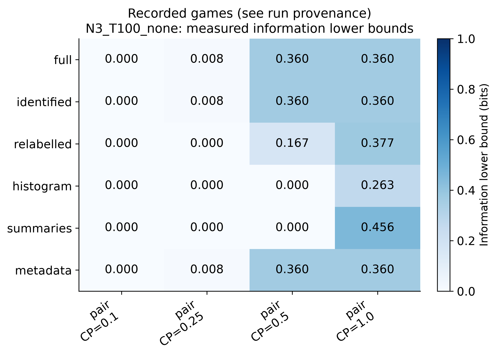
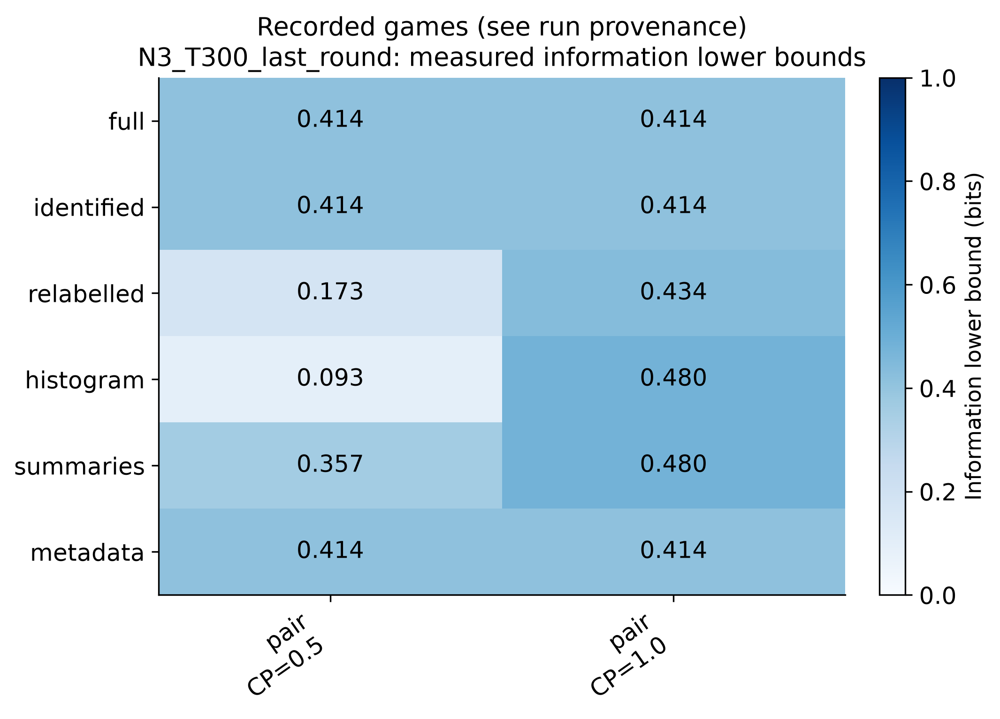
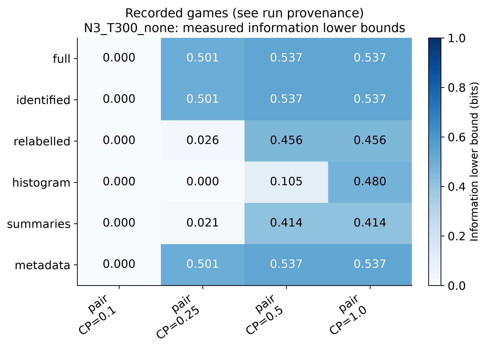
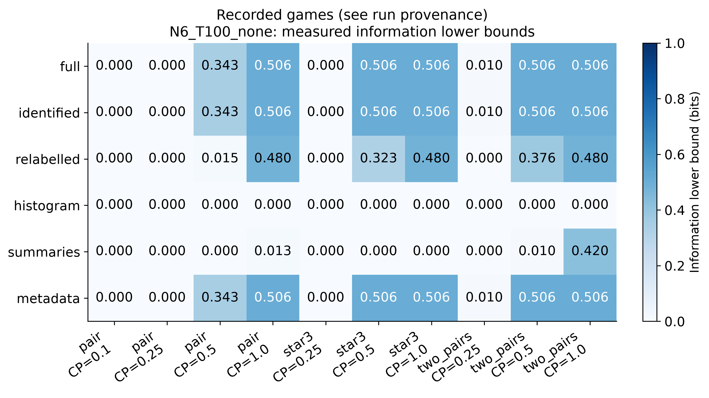
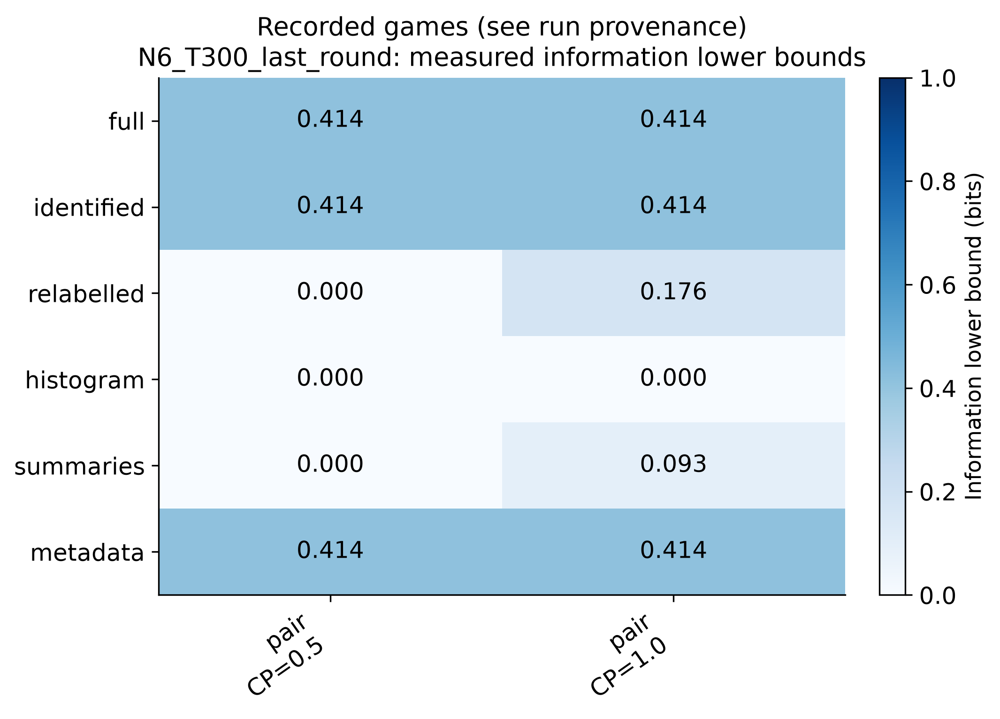
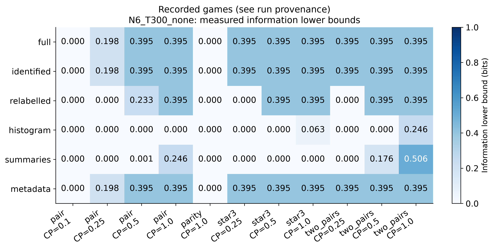
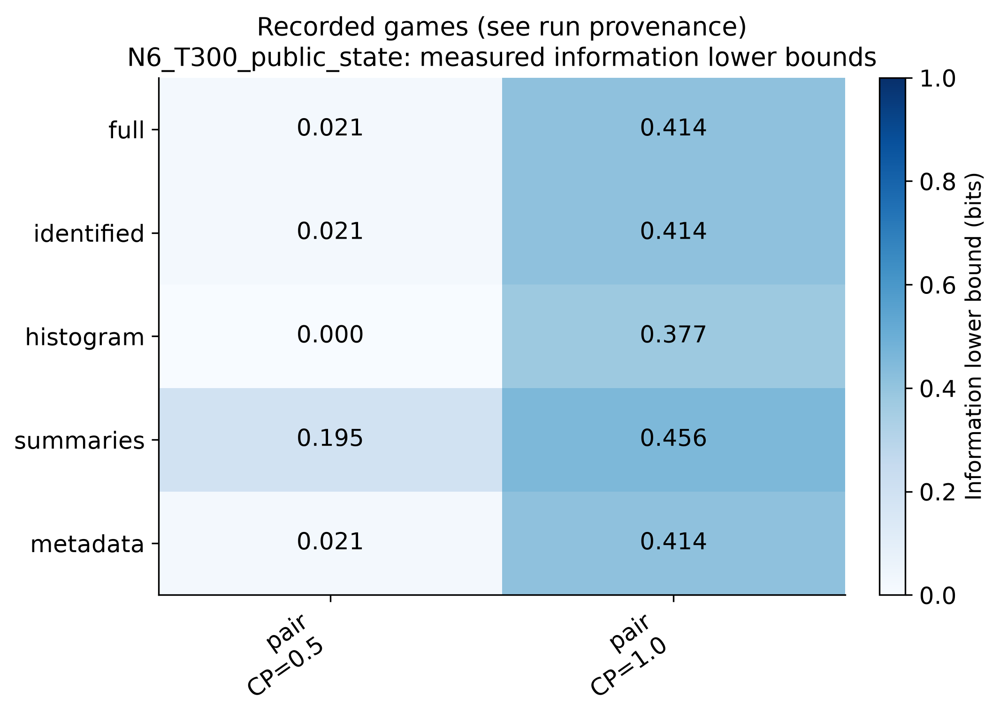

**Figure 1. Recorded games (see run provenance); group N3_T100_none. Detector-based MI lower bounds, not full-view MI estimates. Zero does not establish no information; bounds cannot rank true view information. Blank cells are unavailable. See information.json for test counts, thresholds, family confidence and assumptions. Infinite calibration cutoffs, when present, prevent flags rather than establish that the scores have no useful separation.**

**Figure 2. Recorded games (see run provenance); group N3_T300_last_round. Detector-based MI lower bounds, not full-view MI estimates. Zero does not establish no information; bounds cannot rank true view information. Blank cells are unavailable. See information.json for test counts, thresholds, family confidence and assumptions. Infinite calibration cutoffs, when present, prevent flags rather than establish that the scores have no useful separation.**

**Figure 3. Recorded games (see run provenance); group N3_T300_none. Detector-based MI lower bounds, not full-view MI estimates. Zero does not establish no information; bounds cannot rank true view information. Blank cells are unavailable. See information.json for test counts, thresholds, family confidence and assumptions. Infinite calibration cutoffs, when present, prevent flags rather than establish that the scores have no useful separation.**

**Figure 4. Recorded games (see run provenance); group N6_T100_none. Detector-based MI lower bounds, not full-view MI estimates. Zero does not establish no information; bounds cannot rank true view information. Blank cells are unavailable. See information.json for test counts, thresholds, family confidence and assumptions. Infinite calibration cutoffs, when present, prevent flags rather than establish that the scores have no useful separation.**

**Figure 5. Recorded games (see run provenance); group N6_T300_last_round. Detector-based MI lower bounds, not full-view MI estimates. Zero does not establish no information; bounds cannot rank true view information. Blank cells are unavailable. See information.json for test counts, thresholds, family confidence and assumptions. Infinite calibration cutoffs, when present, prevent flags rather than establish that the scores have no useful separation.**

**Figure 6. Recorded games (see run provenance); group N6_T300_none. Detector-based MI lower bounds, not full-view MI estimates. Zero does not establish no information; bounds cannot rank true view information. Blank cells are unavailable. See information.json for test counts, thresholds, family confidence and assumptions. Infinite calibration cutoffs, when present, prevent flags rather than establish that the scores have no useful separation.**

**Figure 7. Recorded games (see run provenance); group N6_T300_public_state. Detector-based MI lower bounds, not full-view MI estimates. Zero does not establish no information; bounds cannot rank true view information. Blank cells are unavailable. See information.json for test counts, thresholds, family confidence and assumptions. Infinite calibration cutoffs, when present, prevent flags rather than establish that the scores have no useful separation.**

