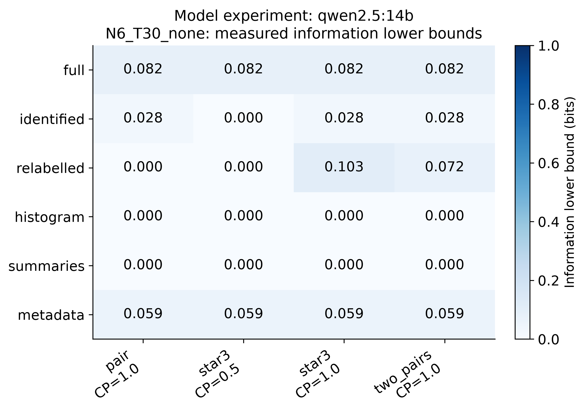

**Figure 1. Model experiment: qwen2.5:14b; group N6_T30_none. Detector-based MI lower bounds, not full-view MI estimates. Zero does not establish no information; bounds cannot rank true view information. Blank cells are unavailable. See information.json for test counts, thresholds, family confidence and assumptions. Infinite calibration cutoffs, when present, prevent flags rather than establish that the scores have no useful separation.**

