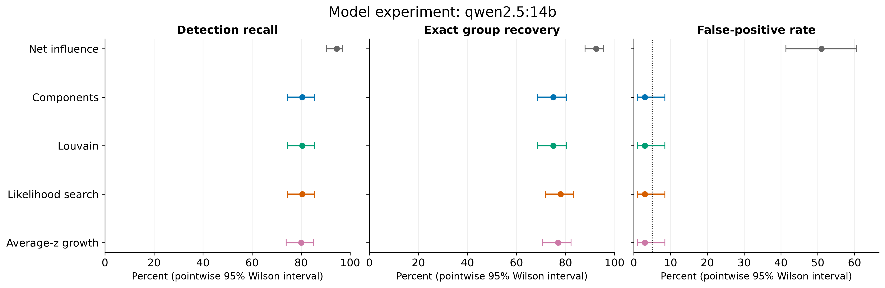
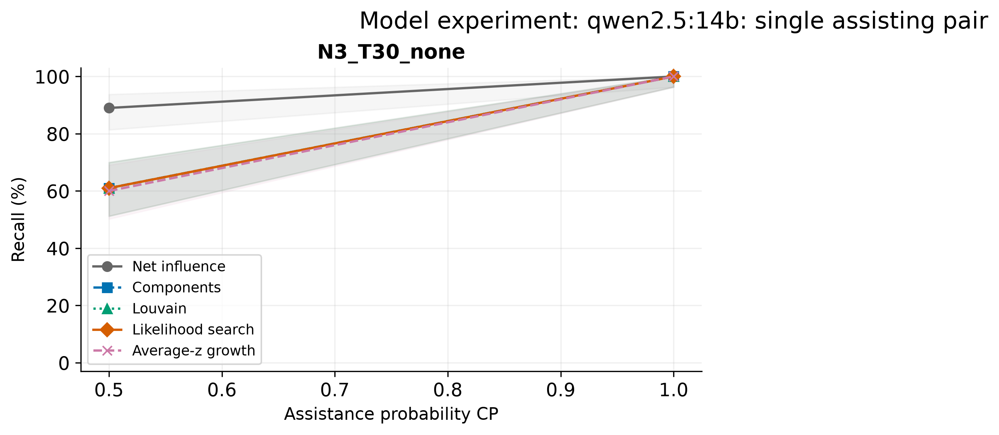

**Figure 1. Model experiment: qwen2.5:14b. Main mixture: 200 coalition and 100 honest test games; pointwise Wilson 95% intervals. Recovery counts misses as failures. Methods have different threshold procedures; this is not a matched-FPR comparison. Stress controls excluded.**

**Figure 2. Model experiment: qwen2.5:14b. Single-pair recall by saved condition; shading shows pointwise Wilson 95% intervals. Counts are in comparison.csv. Lines connect observations, not fitted curves. Groups use separate calibration; tiny test cells are illustrative only.**

